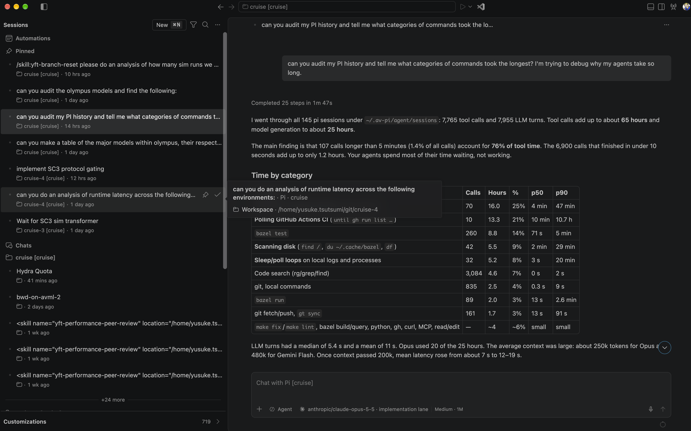

# Reference: agents window

The app's look follows this screenshot (2026-10-16). It was taken at
120% zoom (its 13 px text measures 15.6 points), so compare it with the
app at 1484×927 logical pixels: `just screenshots` renders the app that
way (see [docs/testing.md](../../docs/testing.md)). The requirements are
AV-090 to AV-096 in [specs/agents-view.md](../../specs/agents-view.md).
What to match, by area:

## Theme

- Follow the system light or dark setting unless the user picks one
  (AV-097). The dark theme follows the screenshot's layout: flat
  surfaces, no cards or elevation, hairline borders, muted secondary
  text. Its greys are deliberately a little lighter and fully neutral
  (the default "Graphite" scheme) rather than VS Code's near-black,
  slightly blue greys, with a steel-blue accent instead of VS Code's
  blue. The light theme mirrors it, also a touch greyer than white.
- The other colour themes are the popular VS Code, Neovim and Emacs
  themes (see [docs/themes.md](../../docs/themes.md)): the same layout,
  with each theme's backgrounds, accent, syntax and terminal colours.

## Title bar

- A slim bar: a sidebar toggle, back and forward arrows, the app's name
  ("shireitou") beside them, a centred box naming the open session's
  workspace ("cruise [cruise]"), and on the right an icon toggle for the
  review pane (the change count moves to its tooltip or a small badge).
  On macOS it is drawn in the window's title bar beside the traffic lights.

## Sidebar

- Header: "Sessions", a small "New ⌘N" button, a filter icon (a menu of
  Active, Needs attention, Done, Archived, All, and the sort), a search
  icon that opens the search field, and a "…" menu (Select, Add host,
  Disconnect, host status and Retry).
- Sections, top to bottom: **Pinned**, **Chats** (sessions with no
  working directory), then one section per workspace (one per exact
  working directory, AV-025) labelled "folder [repo]" with a folder
  icon. Headers are an icon and text; no counts, only a small attention
  dot. Hosts are not a level of their own.
- Rows are two lines, about 56 px: a small status dot (a spinner while
  the session is working) and the title in regular weight; then a folder
  icon, "folder [repo]", the host's label when more than one host is
  connected, and the relative time. No status chips or change stats.
- Hovering a row shows pin and "mark done" (archive) icons on its right.
  A longer hover shows a card: the title in bold, "· agent · workspace",
  and "Workspace · full path". The selected row has a subtle fill.
- Not copied: "Automations", "+N more" and the "Customizations" footer.

## Session pane

- Header: the session title on one line and a "…" menu holding
  everything else (model, tokens, details, open in VS Code, rename, pin,
  archive).
  Clicking the title still renames it.
- The user's messages are right-aligned bubbles with a light fill; the
  agent's replies are full-width markdown with no bubble. Markdown tables
  have bordered cells.
- Each turn's tool calls collapse into one line, "Completed N steps in
  1m 47s" ("Working… N steps" while running), which expands to the
  grouped tool calls.
- "Jump to latest" is a small round ↓ button at the bottom right. The
  turn marker rail is thin and shows on hover.

## Composer

- One rounded, bordered box, placeholder "Chat with <agent>
  [<workspace>]". Along its bottom: "+" (attach, disabled until AV-042),
  a mode chip ("Agent"), a model chip ("provider/model · option"), an
  effort and context chip ("Medium · 1M"), and on the right a round
  send button (a filled light circle with a dark up-arrow in dark
  themes, dimmed while the box is empty) that becomes a round stop
  button (the same circle with a solid square) while the agent works. No mic. The new-session draft
  uses the same box.
