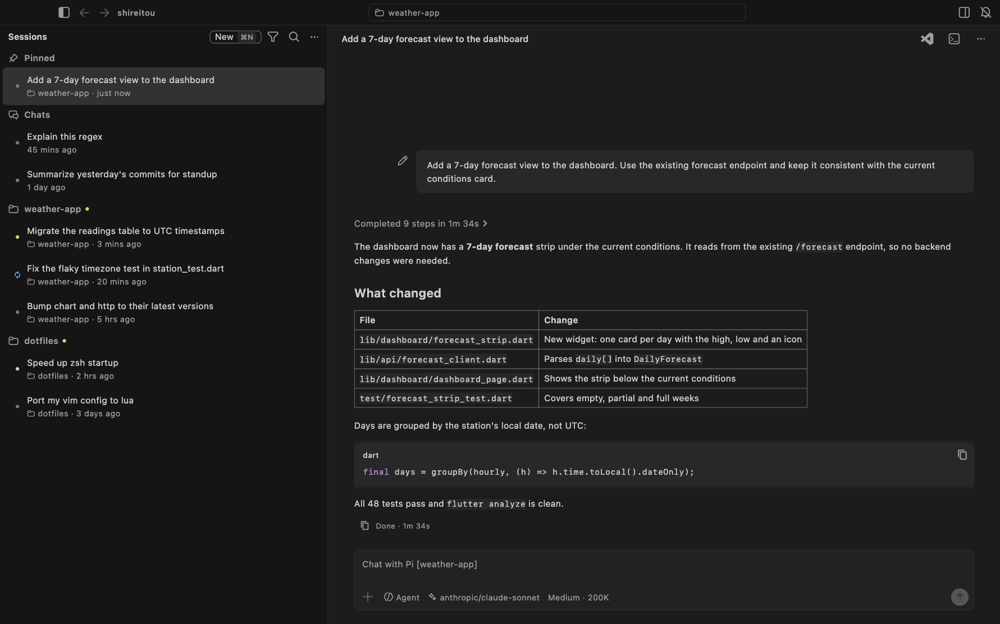

# Dictation (AV-047)

The microphone button in the composer (beside the send button, in a
session's follow-up box and a new session's prompt) turns speech into
text with an open speech-to-text model, OpenAI's
[Whisper](https://github.com/openai/whisper) or NVIDIA's
[Parakeet](https://huggingface.co/nvidia/parakeet-tdt-0.6b-v2), run on
this device. The words appear in the box while you speak, as in Cursor's
and the Agents window's voice input, and the audio never leaves the
device.



## Using it

- Press the microphone. The first time, the app asks which model to
  download into its support folder: Whisper base.en (161 MB, picked
  first) or Parakeet TDT 0.6B v2 (662 MB), each with its trade-off. The
  pick becomes the dictation model, and the button shows the download's
  progress. A model already on disk reads "downloaded" and is used
  without one. The system asks once for microphone access.
- Speak. The utterance you are saying is re-transcribed several times a
  second and shown in the box; when you pause (0.6 s), it is
  transcribed once more, with punctuation, and kept.
- Text goes where the caret was, replacing a selection, with spaces
  added next to the words around it. The placeholder reads "Listening…"
  in an empty box.
- Press the button again (now a filled red microphone) to stop: what you
  were still saying is transcribed. Typing in the box, or sending it,
  also stops dictation and keeps the text as it is.

Dictation is in the desktop apps (macOS, Linux, Windows) and the mobile
apps; the web app has no button yet (see [GAPS.md](../GAPS.md)).

## Models

Pick the model in the first download's dialog, or later in the
sidebar's "…" menu under "Dictation model". The choice is kept on this
device; a model is downloaded the first time you dictate with it (the
dialog opens again, with it picked), and the other stays on disk.

| Model                     | Download | Word errors (Open ASR Leaderboard average) | Notes                                                                                                          |
| ------------------------- | -------- | ------------------------------------------ | -------------------------------------------------------------------------------------------------------------- |
| Whisper base.en (default) | 161 MB   | about 10%                                  | Fastest; full punctuation.                                                                                     |
| Parakeet TDT 0.6B v2      | 662 MB   | about 6%                                   | More accurate, about twice as slow; fewer commas; less prone to making up text in silence. CC-BY-4.0 (NVIDIA). |

On an Apple-silicon laptop, `just test-whisper` gave both models 14
live guesses over a 6.6 s sentence spoken at normal speed. Whisper
loaded in 0.4 s and gave the final text 0.36 s after the speech
ended; Parakeet took 0.8 s and 0.65 s. On a slower machine Parakeet's
guesses come less often (see "The isolate" below), and nothing is lost.

## How it works

Neither model streams: they transcribe whole clips. Live text comes
from re-transcribing the utterance in progress as it grows, which these
models on a laptop CPU do in a fraction of a second.

```text
microphone (record, 16 kHz mono PCM)
  -> PumpedSession: queues audio while the model works or loads
  -> speech isolate (sherpa-onnx: Whisper or Parakeet)
       Silero VAD: where speech starts and where a pause ends it
       LiveTranscriber: every 0.4 s of speech, transcribe the utterance
         so far (a guess); at a pause, transcribe it once more (final)
  -> Transcript (finished utterances + the guess)
  -> DictationAnchor.write: the box's text around the caret + transcript
```

- **sherpa-onnx** ([`sherpa_onnx`](https://pub.dev/packages/sherpa_onnx))
  runs the models' ONNX exports and Silero VAD through FFI on every
  native platform, with prebuilt libraries in the plugin. The models are
  [`csukuangfj/sherpa-onnx-whisper-base.en`](https://huggingface.co/csukuangfj/sherpa-onnx-whisper-base.en)
  (Whisper: encoder and decoder) and
  [`csukuangfj/sherpa-onnx-nemo-parakeet-tdt-0.6b-v2-int8`](https://huggingface.co/csukuangfj/sherpa-onnx-nemo-parakeet-tdt-0.6b-v2-int8)
  (a NeMo transducer: encoder, decoder and joiner), both int8 and pinned
  to a revision; `speechModelConfig` gives sherpa-onnx the settings for
  each kind. The VAD is
  [`silero_vad.onnx`](https://github.com/k2-fsa/sherpa-onnx/releases/tag/asr-models).
- **The isolate.** Decoding blocks for hundreds of milliseconds, so
  the model runs in an isolate of its own (`speech_worker.dart`), which
  takes one request at a time. Audio that arrives meanwhile is sent in
  one batch next time, so the guesses keep up on a slow machine (they
  are just made less often), and nothing said while the model loads is
  lost.
- **Utterances.** The VAD ends an utterance after 0.6 s of silence, or
  after 15 s of speech (Whisper takes at most 30 s, and shorter clips
  keep each guess quick). 0.3 s of audio before the detected start is
  kept so the first syllable is not clipped.
- **Cleanup.** Whisper writes tags such as `[BLANK_AUDIO]` or
  `(wind blowing)` for sounds that are not speech; they are dropped
  (`cleanTranscript`).
- **Models.** `ModelStore` downloads each file to `<name>.part`, checks
  its size, then renames it, so a cut download is fetched again next
  time. The files are in the app support folder under
  `models/<model id>/`, e.g. `models/whisper-base.en/` (on macOS
  `~/Library/Application Support/dev.shireitou.shireitou/models/`); delete
  the folder to download them again.

The code is in `app/lib/src/dictation/` (see
[architecture.md](architecture.md)).

## Platforms

| Platform | Microphone                       | Setup                                                                               |
| -------- | -------------------------------- | ----------------------------------------------------------------------------------- |
| macOS    | AVFoundation                     | `com.apple.security.device.audio-input` entitlement, `NSMicrophoneUsageDescription` |
| Linux    | `parecord` (PulseAudio/PipeWire) | `pulseaudio-utils` (the `.deb` recommends it)                                       |
| Windows  | Media Foundation                 | none                                                                                |
| iOS      | AVFoundation                     | `NSMicrophoneUsageDescription`                                                      |
| Android  | `AudioRecord`                    | `RECORD_AUDIO`, asked for at first use                                              |

## Testing

- `just test` covers the pure parts and the button with fakes:
  `dictation_text_test.dart` (the transcript, writing at the caret, PCM),
  `live_transcriber_test.dart` (guesses and finals with a fake VAD),
  `dictation_session_test.dart` (queueing audio while the engine loads or
  works, stop and cancel), `model_store_test.dart` (downloads, progress,
  cut downloads), `dictation_button_test.dart` (the button in the
  composer, the download dialog's choice of model, typing to stop) and
  `speech_model_test.dart` (the models' files, their sherpa-onnx
  settings, the stored choice and the "Dictation model" menu).
- `just test-whisper` runs each real model: it downloads them (into
  `SHIREITOU_SPEECH_MODELS`, or the temp folder), streams a recorded
  sentence through the worker isolate in 100 ms chunks at the speed of
  speech, checks that guesses came before the final text, and prints
  the load time, the number of guesses and how long the final text took.
  `SHIREITOU_SPEECH_MODEL=parakeet-tdt-0.6b-v2` runs one. It needs macOS
  or Linux and is not run in CI (the downloads).
